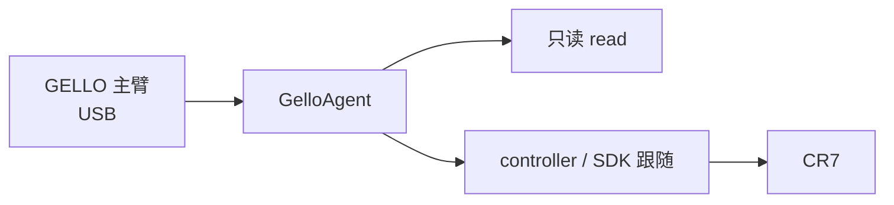

# 架构与使用边界

xcore-gello-software 是 GELLO 上游框架的本地 fork，提供 Dynamixel 主臂读取、
标定和上游实验脚本。controller 只把它当作主臂库使用，CR7 跟随逻辑和标定文件
不放在本仓库。

## 目录

| 路径 | 内容 |
| --- | --- |
| `xcore_gello_software/agents/` | `GelloAgent` 和标定映射 |
| `xcore_gello_software/dynamixel/` | 舵机驱动 |
| `xcore_gello_software/commands/` | CLI 子命令 |
| `config/default.toml` | 本地 `read` 默认参数 |
| `configs/` | 上游 YAML 配置 |
| `scripts/` | 上游标定和可视化脚本 |

## 命令入口

`xcore-gello-software` 是统一的命令分发器：

- `read`：只读主臂和夹爪，不启动跟随。
- `launch-nodes`、`run-env`、`launch-yaml`：上游实验入口。
- `camera-server`、`camera-client`：上游相机节点。

controller 的真实跟随不调用这些实验入口，而是使用 SDK 的 `follow` 流程。

## 标定边界

`read` 默认使用 GELLO 库自己的夹爪端点；需要覆盖时在
`config/default.toml` 的 `[read]` 中设置端点并关闭
`gripper_use_library_endpoints`。CR7 的单姿态标定属于
`xcore-sdk-python/config/cr7_calib.json`，不在本仓库。
